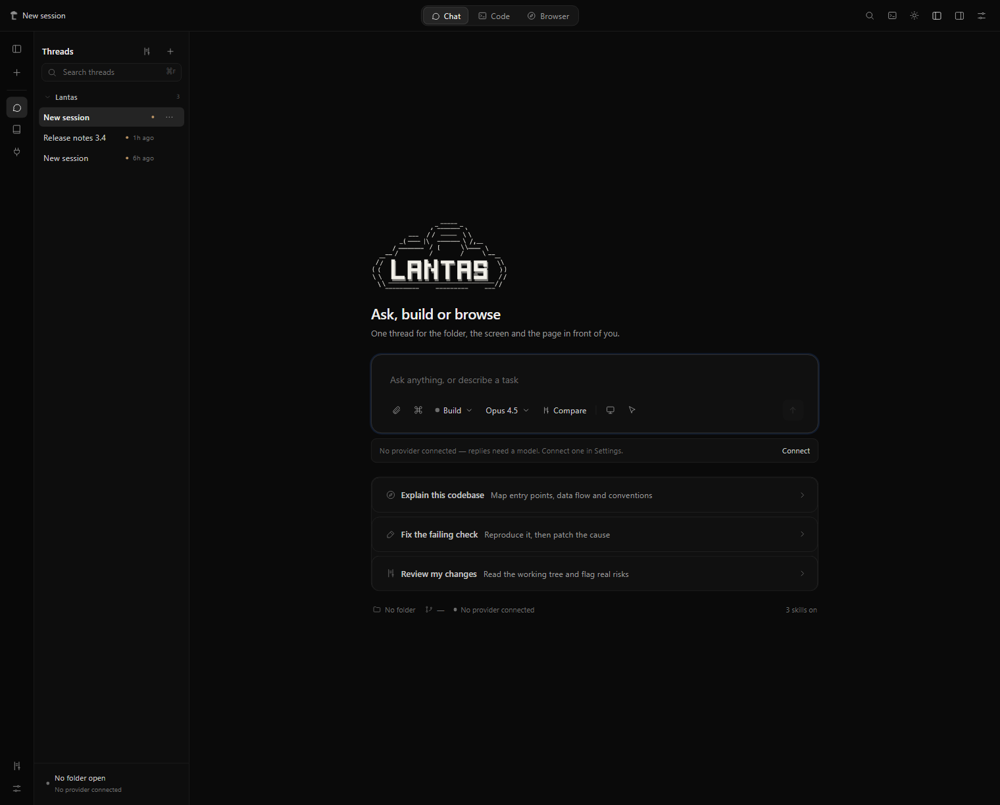
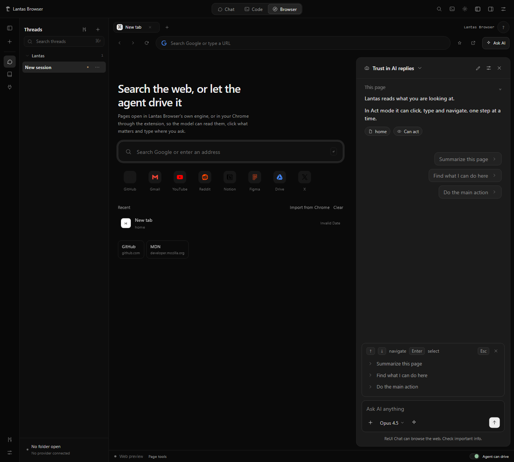
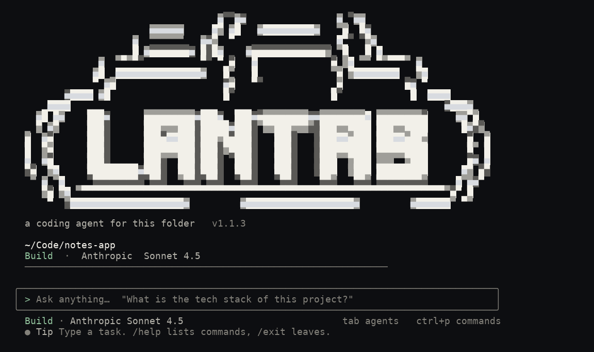

<p align="center">
  <picture>
    <source media="(prefers-color-scheme: dark)" srcset="docs/logo-light.png">
    
  </picture>
</p>

# Lantas

**Chat, code, and a real browser in one window.** Lantas is a local-first macOS agent for work that does not fit in a single tab: ask a question, edit a project, then let the assistant read and drive the page you are looking at.

No account, no subscription, no telemetry. Bring a model key, or run a model locally.

**[Download for macOS →](https://lantas-phi.vercel.app/download.html)** · [Website](https://lantas-phi.vercel.app)

[](https://github.com/AnwarKalonov/Lantas/releases)




## Contents

- [What Lantas is](#what-lantas-is)
- [The three surfaces](#the-three-surfaces)
- [Browser agent design](#browser-agent-design)
- [What is in the app](#what-is-in-the-app)
- [Install](#install)
- [Connect a model](#connect-a-model)
- [Permissions and privacy](#permissions-and-privacy)
- [Project layout](#project-layout)
- [Development](#development)
- [Release and updates](#release-and-updates)
- [Changelog](#changelog)
- [Troubleshooting](#troubleshooting)
- [Credits](#credits)
- [Licence and credit](#licence-and-credit)

## What Lantas is

Lantas is a desktop coding agent with a browser attached. It is built for the ordinary loop of agent work:

1. Read the request and the relevant local context.
2. Take one concrete action.
3. Read the result from the real filesystem or the real page.
4. Continue only from evidence, not from an assumed success.

The same principle applies in every surface. A file write is checked against disk after saving. A browser click returns the new URL, title and controls. A failed tool call is reported as failed.

Lantas runs as a Tauri application on macOS. The React interface also runs in a normal browser for development, with desktop-only features degrading visibly rather than silently.

## The three surfaces

### Chat

A thread per topic with the model you chose. Attach files or images, share a screen frame, and keep long runs manageable with turn checkpoints, context summaries and plan approval.

`⌘K` reaches every session and command. Sessions are stored locally; on desktop they are checkpointed to `~/Library/Application Support/Lantas/sessions.json` after each turn.

### Code

A real workspace, not a code block in a chat. Open a folder and Lantas gets Monaco, an explorer, tabs, quick open, project-wide search and an assistant dock beside the files.

The agent reads before it edits, stages writes as diffs, and checks the file on disk after saving. A terminal panel and your own git are built in. Multi-root workspaces are supported; the file tree, search and git context follow all open folders.

### Browser

A browser with two engines:

- **Lantas Browser** uses a native child webview controlled by the app.
- **Chrome** uses the Lantas Browser Bridge extension to read and drive a tab in the user's own Chrome profile.

Both engines expose the same `browser` tool to the model. The agent reads the DOM — roles, labels, values, visibility and enabled state — and can also take a screenshot when the question is visual. It can click by label or ref, type, fill, select, check, hover, wait, scroll, navigate, list tabs, switch tabs, open tabs and close tabs, or run a page script.



## Browser agent design

The browser is intentionally not a collection of site-specific shortcuts. The app supplies primitives; the model makes decisions.

### One tool, explicit actions

Browser mode exposes exactly one tool:

```json
{"name":"browser","arguments":{"action":"navigate","url":"https://example.com"}}
```

The action set covers reading and acting:

| Action | What it does |
| --- | --- |
| `snapshot` | Read the current URL, title, readable text and numbered controls. |
| `extract` | Return the readable page text. |
| `find` | Locate text on the page. |
| `wait` | Wait for text to appear or disappear. |
| `click` | Click a control by snapshot ref or exact visible label. |
| `click_at` | Click a viewport coordinate for canvas-style interfaces. |
| `hover` | Open a menu or tooltip by ref or label. |
| `type` / `fill` | Type into a field, optionally submitting. |
| `select` / `check` | Choose an option or set a checkbox/switch. |
| `press` | Send a named key. |
| `scroll` | Scroll the page. |
| `tabs` | List open tabs with stable ids and the active tab. |
| `switch_tab` | Make another tab the target. |
| `new_tab` | Open a complete URL in a new tab. |
| `close_tab` | Close a tab by id or index. |
| `navigate` | Open a complete `https://` URL. |
| `back` / `forward` / `reload` | Browser history and refresh. |
| `evaluate` | Run page JavaScript for a site API or a verification read. |
| `execute` | Run async, multi-statement page JavaScript and return its value plus console output; the session stays alive between calls. |
| `screenshot` | Return the page as an image the model can see. Chrome captures through CDP; the native engine captures the live webview. |
| `open_in_chrome` | Hand a login page to the user's real Chrome profile. |

### The model owns destinations

There is no product-name table, no route inference, no comma repair and no automatic Google fallback. If the user says “open the graphing calculator”, the model must decide the exact page and call `navigate` with a complete URL.

If the model sends a bare name, a route such as `calculator`, or a malformed address, the tool refuses it and returns an actionable error. The model can then correct the call. This is deliberate: a silent guess is harder to detect than an explicit rejection.

The native browser address bar still accepts ordinary human input, including a search fallback. That is a user-facing convenience, not an agent decision.

### Observe, act, verify

Every navigation and interaction returns the resulting URL, title and controls. The next step starts from that evidence. The guide tells the model to:

- use a ref or exact label from the latest snapshot, never an invented selector;
- take one action at a time and read the result;
- verify the user-visible outcome before claiming success;
- try one different supported action after a failure instead of repeating it;
- ask before irreversible actions such as payments, deletions, account changes or closing something important.

### Tabs

The browser tool can list, switch, open and close tabs through the same tab strip the user sees. Native tab actions are delivered to `BrowserView` as events, so the UI and the agent cannot drift onto different tabs. Chrome tab actions use stable extension tab ids.

### Safety and trust boundaries

- Tool calls are checked against ordered permission rules (`allow`, `ask`, `deny`; last match wins).
- Build can write and run; Plan and Chat are read-only.
- Browser mode restricts the tool list to `browser`.
- Snapshots pierce open shadow roots and same-origin iframes; cross-origin documents remain inaccessible.
- Page text and page instructions are untrusted data. The model is told not to follow instructions found in a page.
- `evaluate` is available for a site's documented API and verification, not for reading private storage or changing unrelated settings.
- Chrome page access stays in the user's own profile through the extension; the app does not receive the user's Chrome password.

## What is in the app

- **Build, Plan and Chat agents.** Build can write and run; Plan and Chat are read-only. Plan approval and max-step continuation keep long tasks predictable.
- **Any model, and two at once.** Anthropic, OpenAI, OpenRouter, OpenCode Zen, Groq, Google, NVIDIA NIM, Ollama, LM Studio and any OpenAI-compatible endpoint. Test a connection and fetch its model list from Settings. **Compare** lives inside Chat, asks two models the same question in two columns, and shows time, tokens and a Faster mark.
- **A small, explicit toolset.** `read`, `glob`, `grep`, `semantic_search`, `write`, `edit`, `terminal`, `browser`, `skill` and connected-app tools. Writes are verified against disk.
- **Diffs you approve.** Assistant edits in Code mode are staged. Review a side-by-side diff and Keep or Discard each file, or all of them, from the review bar.
- **A real terminal, and the real Terminal.** Run commands in the workspace, see live stdout/stderr in the terminal panel, and get the same output in the transcript. **CLI in Terminal** opens Terminal.app already running `lantas` in the open folder, and the title-bar terminal button does the same on the desktop.
- **Project context.** Git status, branches, changed files, a file map, semantic search and an optional project summary feed the prompt instead of the whole repository.
- **Browser verification, with a visible hand.** Snapshot, readable text, shadow DOM, forms, waits, tab control and a Chrome handoff. The agent's blue pointer glides to each control and ripples on a click, in the native browser and in Chrome. Each action returns a fresh page read plus the lines of text that changed, so the model reads the result as text instead of taking a screenshot. A browser task is not done until the page says so.
- **Skills and commands.** Built-in procedures for commits, review, debugging, test gaps, refactors, release notes, PR descriptions, API design, SQL, security and interface copy. Import your own `SKILL.md` folders or zips; repeat work is a slash command.
- **MCP and integrations.** HTTP and stdio MCP servers, plus Composio toolkits for Gmail, Slack, Notion, Linear, GitHub, Drive and more. Read-only Gmail through your own OAuth client is also available.
- **Session durability.** Desktop sessions are checkpointed after each turn. If browser storage is cleared, **Settings → General → Restore from disk** brings them back. The web build falls back to local storage.
- **Updates.** The installed macOS app checks the newest public release, verifies the bundle signature against the key compiled into the app, and offers **Restart to update** in the title bar.

## Install

Download the current macOS build from the [website](https://lantas-phi.vercel.app/download.html) or the [releases page](https://github.com/AnwarKalonov/Lantas/releases). Unzip it and drag **Lantas.app** to Applications.

Releases and the source live in the same public repository, so those links and the in-app updater work without an account.

The app is ad-hoc signed and not notarized. On first launch, macOS may ask you to approve it once:

1. Open **System Settings → Privacy & Security**.
2. Find the Lantas notice and click **Open Anyway**.
3. Authenticate.

The current source tree is version **1.3.0**. The tagged macOS workflow builds the `.dmg`, app zip, Chrome extension and updater assets, then publishes them with the workflow's built-in GitHub token.

### Run from source

```bash
npm install
npm start
```

`npm start` reuses a running dev server on port 3000, or starts Vite and opens a chromeless app window. In a headless environment it prints the URL for the Browser panel.

```bash
PORT=1700 npm start       # another port
npm run dev               # Vite only
npm run build             # typecheck + production build
npm run tauri dev         # native window (macOS, Rust and Xcode required)
npm run tauri build       # signed .app and .dmg
```

Building the native shell needs Rust, Xcode command-line tools and, on Linux, `libwebkit2gtk-4.1` and `libgtk-3`. See [`PUBLISH.md`](PUBLISH.md) for the signing and release flow.

### Chrome bridge

Install the unpacked extension from `chrome-extension/`:

1. Open `chrome://extensions`.
2. Enable **Developer mode**.
3. Choose **Load unpacked** and select the `chrome-extension` folder.
4. Keep the Lantas desktop app running so the extension can connect.

The extension is version `0.7.0`. Reload it after changing extension files. Every tab the agent opens lands in a blue Chrome tab group named **agents**; the pill in the panel header focuses that group or starts it, so agent work never buries the tab you are reading.

### Terminal app



The same agent also runs without a window. One command installs it and makes `lantas` available everywhere:

```bash
bash scripts/install-cli.sh   # copies the CLI to ~/.local/bin and adds it to PATH
lantas setup                  # connect a provider once
lantas                        # start a session in the current folder
```

The installer writes to `~/.local/share/lantas`, symlinks `~/.local/bin/lantas`, and appends one `export PATH=` line to `~/.zshrc` (or `~/.bashrc`) only when that folder is missing from `PATH`. Set `LANTAS_PREFIX` to install somewhere else. Node 18+ is the only requirement.

Then ask it for work from any folder:

```bash
lantas "find the failing test and fix it"
lantas --plan "explain how src/lib/agentRuntime.ts runs a turn"
lantas --model claude-sonnet-4-5 --provider anthropic
lantas compare "should this be a map or a list?"
```

Inside a session, `/compare <question>` prints both answers with time and token count, `/compare-model <name>` picks the second model, `/web <url>` reads a page as text, and `/auto` stops asking before writes and commands. Plan mode is read-only. Build mode asks before each write or command, and `--yes` approves them up front. The CLI keeps its config in `~/.lantas/config.json` with mode `0600`, or reads the provider's usual environment variable. Running it from the repository without installing also works: `node cli/lantas.mjs` or `npm run cli`.

## Connect a model

1. Open **Settings → Providers**.
2. Pick a provider, paste a key, and press **Test connection**.
3. Press **Fetch models** to fill the model list.
4. Choose a default model in **Settings → Models**, or per session from the composer.

With no provider connected, Lantas does not fake a reply: the composer points you at Settings.

Local models work through Ollama or LM Studio. For Ollama in a browser tab, start it with:

```bash
OLLAMA_ORIGINS=* ollama serve
```

Keys live in the app's local storage, unencrypted. Use a scoped key you can rotate. The desktop build sends provider requests through Tauri's HTTP client, so keys are not exposed to webview CORS. Add a custom endpoint's host to `src-tauri/capabilities/default.json`.

## Permissions and privacy

Lantas asks before it uses anything. On first launch a permission sheet lists the four capabilities, and each one is a separate grant: **files** (read and edit the folder you opened), **commands** (builds, tests and git in that folder), **screen** (attach a screenshot to a turn) and **computer control** (click, type and scroll in the browser, or in the floating screen card across apps). *Allow these* saves the grants; *Not now* leaves them off. Reopen the sheet any time from **Settings → Permissions → Review permissions**.

The grants are enforced in the tool layer, not just in the interface: `read`, `glob`, `grep`, `write`, `edit` and `semantic_search` are refused without file access, `terminal` without the command grant, and every browser action except `snapshot`, `extract` and `find` without computer control. The floating screen card uses the same switch before it touches the pointer or keyboard. A denied tool returns a plain “not allowed” message that tells the model to ask, not to retry another way.

Screen Recording and Accessibility are also granted by macOS. Lantas opens the right System Settings pane and offers a one-frame capture test, but only the user can flip the switch; Screen Recording takes effect after a relaunch.

On top of the grants, tool calls are checked against ordered rules. **Settings → Agents** controls whether Build asks before every write and command or runs automatically. Destructive actions and arbitrary connected-app calls ask. Plan and Chat cannot write.

No usage telemetry is sent anywhere. Provider requests go directly to the provider. Browser page content is sent only to the model you chose when you ask the agent to work on it. The full data-flow list is the site's [privacy policy](Website/site/privacy.html).

The source is public for transparency, but it remains under the source-available Lantas License 1.0 rather than an open-source licence; see [Licence and credit](#licence-and-credit).

## Project layout

```text
src/            React app: Chat, Code, Browser, settings, sessions
src/lib/        store, providers, agent loop, tools, browser, git, search
src/components/ UI, Monaco, diff viewer, browser chrome, title bar
src-tauri/      Tauri 2 shell: macOS window, terminal, HTTP bridge, updater
cli/            dependency-free terminal agent
chrome-extension/ Chrome bridge: background service worker, content script, side panel
Website/site/   source for the public website
public-repo/    the static site deployed to the website
docs/           screenshots used here
scripts/        launch, build and release helpers
```

## Development

```bash
npm install
npx tsc --noEmit        # typecheck only
npm run build           # typecheck + Vite production build
node --check chrome-extension/background.js
node --check chrome-extension/content.js
```

Notes:

- `npm run build` runs `tsc --noEmit` before Vite, so a type error fails the build.
- Browser automation requires either the built-in browser or the Chrome extension. If Chrome is not connected, the browser tool reports that instead of pretending to click.
- The app runs as a web page too. Desktop-only features (disk persistence, native terminal, screen capture, updater) degrade with a visible error rather than a silent failure.
- The website and release copy are generated from `public-repo/`; do not publish the app source to that repository.
- The Chrome extension is a separate unpacked extension. Bump `chrome-extension/manifest.json` and `VERSION` in `chrome-extension/background.js` when its behavior changes, then reload it.

### Browser changes

Browser behavior lives in:

- `src/lib/browserAgent.ts` — address validation, snapshots, page actions, tab actions and the shared browser guide.
- `src/lib/tools.ts` — the `browser` tool schema, action dispatch and result verification.
- `src/lib/chat.ts` — the browser-only system prompt.
- `src/lib/browserTurn.ts` — the Chrome side-panel turn loop.
- `chrome-extension/background.js` and `content.js` — the Chrome bridge and its DOM actions.
- `src/components/BrowserView.tsx` — the visible tab strip, address bar and native webview bounds.

When changing an agent action, update the guide, the tool result text and the extension fallback together. A browser action is not complete until the page or the user's tab strip confirms it.

## Release and updates

Tagged releases are built by `.github/workflows/macos.yml` on an Apple Silicon runner. The workflow:

1. checks the tag matches `src-tauri/tauri.conf.json`;
2. builds the Tauri app;
3. verifies the app signature;
4. packages the `.dmg`, app zip, Chrome extension and updater assets;
5. uploads the build as an artifact;
6. publishes the release in `AnwarKalonov/Lantas` with the workflow's built-in `GITHUB_TOKEN`.

The public site is generated from `public-repo/`. Vercel deploys that folder from the same repository; no separate download repository or release token is involved.

The repository is public, so GitHub serves release assets and the `latest.json` updater feed to anyone.

Download links on the site never need editing. Every button points at `releases/latest` and carries a `data-dl` kind (`dmg`, `app`, `extension`); `assets/site.js` reads the latest release from the GitHub API on load and swaps in that build's real asset URLs, name and version. If the API is unreachable the buttons still land on the newest release page instead of a dead file.

The website's download total and the badge above both read GitHub's asset download counts. The site sums every public release in the browser and caches the answer for ten minutes; the badge is generated by shields.io from the same public numbers. Nothing is tracked per person.

## Changelog

Every version, and what changed in it, is recorded in [`CHANGELOG.md`](CHANGELOG.md). Product changes are written there as they land, under **Unreleased**, and move under the version number when a release is cut. The long-form notes for the current release are in [`RELEASE_NOTES.md`](RELEASE_NOTES.md).

When changing the app or site, add a short entry in the same commit. Keep it about what a person using Lantas will notice, not internal process. [`PUBLISH.md`](PUBLISH.md) covers the version bump, tag, build and site sync.

## Troubleshooting

### The app opens but the model does not answer

Open **Settings → Providers**, test the connection and fetch models. A missing key is shown in the composer; Lantas will not invent a reply.

### Chrome says the extension is not connected

Start the desktop app, reload the extension at `chrome://extensions`, and open a normal `http(s)` page. Browser pages and the Chrome Web Store cannot be read by the content script.

### A browser action says the address is not full

That is intentional. Send a full `https://` URL, or navigate to the site first and click the page you want. The app will not guess a domain or turn a route into a search.

### The browser tool cannot find a control

Take a fresh snapshot. Refs belong to the latest snapshot; a page change can make an old ref stale. Use the exact label from the new snapshot, or `evaluate` to inspect a shadow root before trying again.

### The macOS build is not notarized

Use **System Settings → Privacy & Security → Open Anyway** once. The app is ad-hoc signed; the absence of notarization is not a sign that the download is corrupt.

### The release or website did not update

Check the Actions run. The publish step uses the workflow's built-in `GITHUB_TOKEN`; make sure the workflow has `contents: write` permission. Never paste a token into a chat, source file or commit.

## Credits

- Chromium, Chrome and their marks belong to their respective owners. Lantas is not affiliated with Google.
- The interface is built on React, Vite, Monaco and Tauri, with the model providers listed in `package.json`.

## Licence and credit

Lantas is free to download and use, but it is **not open source**. It is covered by the **Lantas License 1.0** ([`LICENSE`](LICENSE)):

- Use it, free of charge, for personal or commercial work, on machines you control.
- Do not redistribute it, sell it, host it as a service or bundle it into a product.
- Do not strip the Lantas name, the copyright line or the project links.
- If you build a derivative and distribute it, that derivative must be licensed under the same terms, must credit **“Based on Lantas, originally by Anwar Kalonov — https://github.com/AnwarKalonov”** in its about screen, README and website, and must publish its complete source free of charge.

That last rule is the one that matters: a fork cannot go closed, cannot drop the credit and cannot be sold. [`NOTICE`](NOTICE) has the credit line to reproduce, and the site's [terms page](Website/site/terms.html#licence) has the same licence in readable form.

This is a source-available licence: the source is public, but redistribution and closed forks are still restricted. Have a lawyer look at it before you rely on it commercially.
