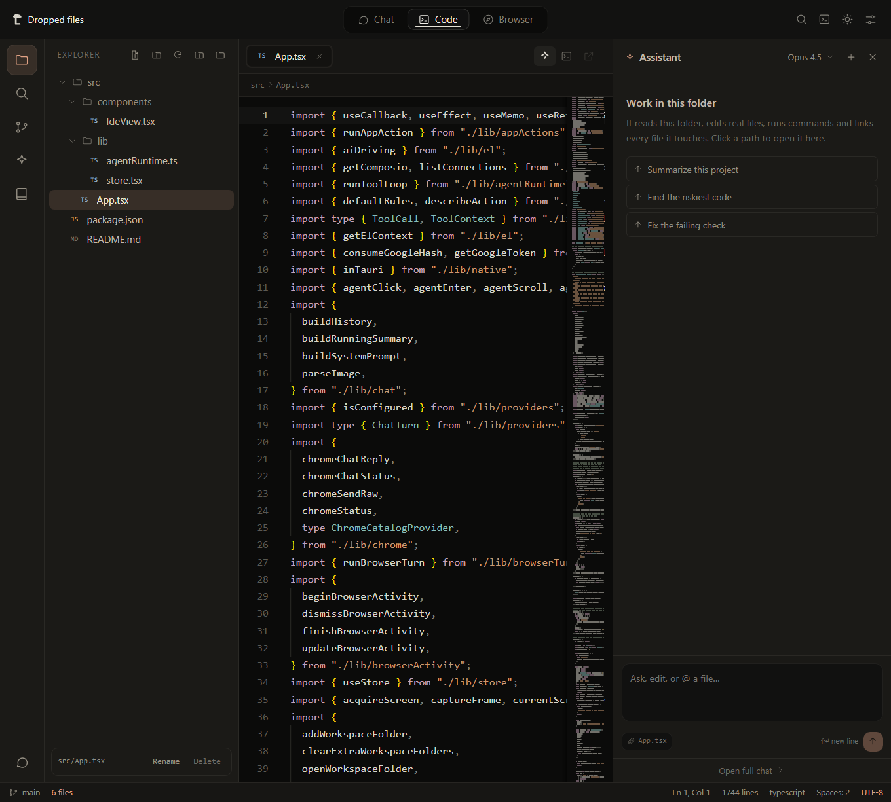
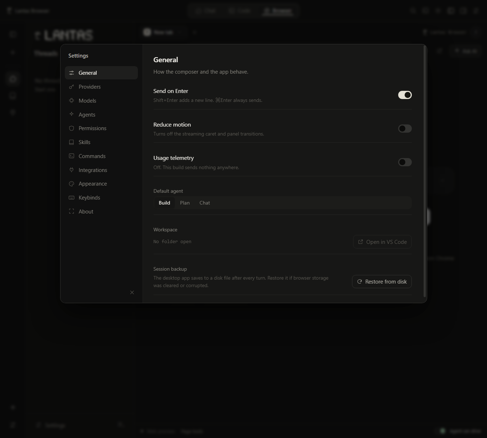

# Lantas

**Chat, code, and your browser in one window.** Lantas is a free macOS agent for the work that does not fit in one tab: ask a question, edit a real project, and let the assistant read the page you are looking at.

No account, no subscription, no telemetry. Bring a model key, or run a model locally.


## The three surfaces

### Chat

A thread per topic with the model you chose. Attach files or images, share a screen frame, and keep working through long runs with turn checkpoints, context summaries and plan approval. `⌘K` reaches every session and command.

### Code

A real workspace, not a code block in a chat. Open a folder and Lantas gets Monaco, an explorer, tabs, quick open, project-wide search and an assistant dock beside the files. It reads before it edits, stages writes as diffs, then checks the file on disk after saving. A terminal panel and your own git are built in.



### Browser

A browser with its own engine, plus a Chrome bridge for the tabs you already have open. Lantas reads the DOM — roles, labels, values, what is visible and enabled — instead of guessing from a screenshot. It can click by label, type, scroll, navigate, wait for a result and re-read the page to verify what happened.


### Settings

Providers, models, agents, permissions, skills, commands, MCP integrations, appearance and keybinds live in one place. Permission rules are visible and editable, and every tool call is checked against them before it runs.



## What is in the app

- **Build, Plan and Chat agents.** Build can write and run; Plan and Chat are read-only. Plan approval and max-step continuation keep long tasks predictable.
- **Any model.** Anthropic, OpenAI, OpenRouter, Groq, Google, NVIDIA NIM, Ollama, LM Studio and any OpenAI-compatible endpoint. Test a connection and fetch its model list from Settings.
- **Ten tools.** `read`, `glob`, `grep`, `semantic_search`, `write`, `edit`, `terminal`, `browser`, `skill` and connected-app tools. Writes are verified against the file on disk, not just reported.
- **Diffs you approve.** Assistant edits in Code mode are staged. Review a side-by-side diff and Keep or Discard each file, or all of them, from the review bar.
- **A real terminal.** Run commands in the workspace, see live stdout/stderr in the terminal panel, and get the same output in the transcript.
- **Multi-root workspaces.** Add more than one folder to a session; the file tree, search and git context follow all of them.
- **Project context.** Git status, branches, changed files, a file map, semantic search and an optional project summary feed the prompt instead of the whole repository.
- **Browser verification.** Snapshot, DOM extraction, shadow DOM, forms, waits and a Chrome handoff. A browser task is not done until the page says so.
- **Skills and commands.** Thirteen built-in procedures for commits, review, debugging, test gaps, refactors, release notes, PR descriptions, API design, SQL, security and interface copy. Import your own `SKILL.md` folders or zips; repeat work is a slash command.
- **MCP and integrations.** HTTP and stdio MCP servers, plus Composio toolkits for Gmail, Slack, Notion, Linear, GitHub, Drive and more. Read-only Gmail through your own OAuth client is also available.
- **Session durability.** On desktop, sessions are checkpointed to `~/Library/Application Support/Lantas/sessions.json` after each turn. If browser storage is cleared, **Settings → General → Restore from disk** brings them back. The browser build falls back to local storage.
- **Updates.** The installed macOS app checks the newest public release, verifies the bundle signature against the key compiled into the app, and offers **Restart to update** in the title bar.

## Install

Download the latest macOS build from the [public releases page](https://github.com/AnwarKalonov/Lantas-download/releases/latest). Unzip it and drag **Lantas.app** to Applications.

Lantas 1.0.5 requires macOS 11 or newer. The app is not notarized, so the first launch needs **System Settings → Privacy & Security → Open Anyway**.

### Run from source

```bash
npm install
npm start
```

`npm start` reuses a running dev server on port 3000, or starts Vite and opens a chromeless app window. In a headless environment it prints the URL for the Browser panel.

```bash
PORT=1700 npm start   # another port
npm run build         # typecheck + production build
npm run tauri dev     # native window (macOS, Rust and Xcode required)
npm run tauri build   # signed .app and .dmg
```

Building the native shell needs Rust, Xcode command-line tools and, on Linux, `libwebkit2gtk-4.1` and `libgtk-3`. See [`PUBLISH.md`](PUBLISH.md) for the signing and release flow.

### Terminal app

The same agent also runs without a window:

```bash
node cli/lantas.mjs          # or npm run cli
bash scripts/install-cli.sh  # installs `lantas` under ~/.local/bin
lantas setup
lantas "find the failing test and fix it"
```

Use `--plan` for read-only work. The CLI keeps its config in `~/.lantas/config.json` with mode `0600`, or reads the provider's usual environment variable.

## Connect a model

1. Open **Settings → Providers**.
2. Pick a provider, paste a key, and press **Test connection**.
3. Press **Fetch models** to fill the model list.
4. Choose a default model in **Settings → Models**, or per session from the composer.

With no provider connected, Lantas does not fake a reply: the composer points you at Settings. Local models work through Ollama or LM Studio; for Ollama in a browser tab, start it with `OLLAMA_ORIGINS=* ollama serve`. Keys live in the app's local storage, unencrypted. Use a scoped key you can rotate.

## Permissions and privacy

Tool calls are checked against ordered rules (`allow`, `ask`, `deny`; last match wins). **Settings → Agents** controls whether Build asks before every write and command or runs automatically. Reads are local and cheap. Destructive actions and arbitrary connected-app calls always ask. Plan and Chat cannot write.

No usage telemetry is sent anywhere. Provider requests go directly to the provider. In the desktop build they use Tauri's HTTP client, so provider keys are not exposed to webview CORS; add a custom endpoint's host to `src-tauri/capabilities/default.json`.

The source repository is private. The public repository at [AnwarKalonov/Lantas-download](https://github.com/AnwarKalonov/Lantas-download) contains the website and signed release assets only — no application source.

## Project layout

```
src/            React app: Chat, Code, Browser, settings, sessions
src/lib/        store, providers, agent loop, tools, browser, git, search
src/components/ UI, Monaco, diff viewer, browser chrome, title bar
src-tauri/      Tauri 2 shell: macOS window, terminal, HTTP bridge, updater
cli/            dependency-free terminal agent
Website/site/   source for the public website
public-repo/    the files published to Lantas-download
docs/           screenshots used here
scripts/        launch, build and release helpers
```

## Development notes

- `npm run build` runs `tsc --noEmit` before Vite, so a type error fails the build.
- Browser automation requires either the built-in browser or the Chrome extension. If Chrome is not connected, the browser tool reports that instead of pretending to click.
- The app runs as a web page too. Desktop-only features (disk persistence, native terminal, screen capture, updater) degrade gracefully with a visible error rather than a silent failure.
- The website and release copy are generated from `public-repo/`; do not publish the app source to that repository.

## License

Lantas is free to download and use. The source is not public.
