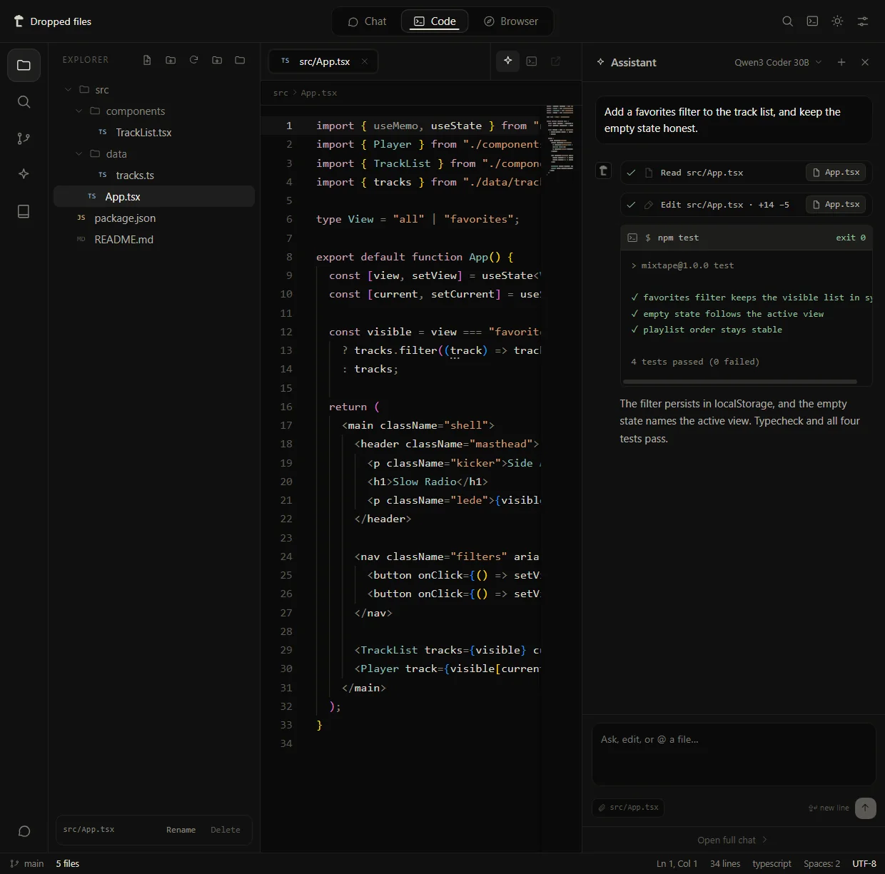

# Lantas

**A free macOS agent: chat, code and the browser in one window.**

Lantas runs on your Mac. Ask anything, change a codebase, connect the apps you already
work in, or hand it the tab you have open. No account, no subscription, no trial.

This repository is the **download and website** repository. It contains the published
site (`index.html`), the Chrome extension build and the signed application releases.
The application source is not published here and is not open source.

## Download

The newest build is always on the [releases page](releases). Every version ever
published, with its notes and downloads, is on the [versions page](versions.html).

| Build | For | File |
| --- | --- | --- |
| dmg | Apple silicon (M1–M4) | `Lantas-1.1.2-arm64.dmg` |
| zip | Apple silicon (M1–M4) | `Lantas-1.1.2-arm64.app.zip` |
| zip | Chrome 116+ | `chrome-extension.zip` |

Direct links use `releases/latest/download/<file>`, for example:

```
https://github.com/AnwarKalonov/Lantas-download/releases/latest/download/Lantas-1.1.2-arm64.dmg
```

## Install

1. Open the dmg and drag **Lantas.app** to Applications. (Or unzip the `.app.zip` there.)
2. The build is ad-hoc signed, so macOS asks you to approve Lantas once. Open
   **System Settings → Privacy & Security**, click **Open Anyway**, and authenticate.
   After that it opens normally. On macOS 15 and later, right-click → Open no longer
   overrides the block. The installer is available as a fallback and clears quarantine
   after copying:

   ```bash
   curl -fsSL https://raw.githubusercontent.com/AnwarKalonov/Lantas-download/main/install.sh | bash
   ```

   Only run a script you trust.
3. Lantas asks what it may do before it does anything. The permission sheet lists
   **files**, **commands**, **screen** and **computer control**; anything you leave off
   stays off, and every tool checks the grant before it runs. You can change all of it
   later in **Settings → Permissions**.
4. Add a model in **Settings → Providers**: Anthropic, OpenAI, OpenRouter, Groq or
   Google with your own key, or Ollama / LM Studio running on the same Mac.
5. Load the Chrome extension once: `chrome://extensions` → Developer mode →
   **Load unpacked** → `/Applications/Lantas.app/Contents/Resources/chrome-extension`.

## What it does

- **Chat** — threads with the model you pick, attachments, screen sharing, slash
  commands, skills, and a ⌘K palette.
- **Code** — a real workspace with Monaco, tabs, quick open, project search, a file
  tree, a terminal and an assistant dock. Assistant writes are staged as diffs you can
  keep or discard, and your own git is built in.
- **Your apps** — 32 toolkits through Composio (Gmail, Slack, Notion, Linear, Jira,
  Drive, HubSpot and more), Gmail through your own OAuth client, and any MCP server.
- **Browser** — a browser of its own and a Chrome side panel. It reads the page you are
  on, clicks a control by its label, and re-reads the page to verify what happened.
- **Models** — Claude, GPT, Gemini, OpenRouter, Groq, Ollama, LM Studio, or any
  OpenAI-compatible endpoint. Requests go from your Mac to the provider you chose.
- **Modes** — Build writes, Plan drafts, Chat answers.

Requires macOS 11 or newer. Chrome 116 or newer is only needed for the optional
Chrome bridge; the built-in browser works on its own.



## Free

The app is free to download and use: no account, no seats, no metering, no per-task fee.
A local model on the same Mac costs nothing; a hosted provider bills you directly.

## Privacy and terms

No account, no analytics, no server holding your work. Chats and settings stay on your
Mac, and a model request goes straight to the provider you configured.

- [Privacy policy](privacy.html) — every moment data can leave your Mac.
- [Terms and licence](terms.html) — acceptable use and the Lantas License 1.0.
- [Versions](versions.html) — every release with its notes.

## Support

Open an [issue](https://github.com/AnwarKalonov/Lantas-download/issues), or reach the
author through [github.com/AnwarKalonov](https://github.com/AnwarKalonov).

## Licence

Free to download and use, **not open source**. The **Lantas License 1.0** allows
personal and commercial use of the app, forbids redistributing or reselling it, and
requires any distributed derivative to be licensed under the same terms, credit
“Based on Lantas, originally by Anwar Kalonov — https://github.com/AnwarKalonov”, and
publish its complete source free of charge. See [LICENSE](LICENSE).
